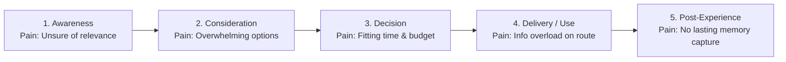

# Chronopath Navigator — UX Case Study & Interactive Prototype

> **Course Submission Portfolio Document**  
> **Product:** Chronopath Navigator (Pune, Maharashtra edition)  
> **USP:** *"Transforms navigation from simply finding a route into discovering the places, experiences, food, culture, and stories along the journey, personalized to every traveler."*  
> **Prototype URL:** `http://localhost:8080/index.html` (or open `index.html` directly in any browser)

---

## 1. Executive Summary & First-Time User Experience (FTUE) Redesign

### The Initial Usability Problem
During initial usability testing, travelers reported cognitive overload upon landing:
- **Too many concurrent inputs:** Sliders, multi-select chips, and dense metadata forced users to make 8 decisions before seeing a single route.
- **Abstract visual representation:** Early wireframes relied on CSS gradients and flat vector silhouettes, failing to convey the sensory richness of Pune's street food, architectural wadas, and historical ruins.
- **Unclear entry point for beginners:** Casual tourists wanted an instant *"Show me Pune in 2 hours"* button without filling out preference surveys.

### The Design Response: Progressive Simplicity & Visual Delight
To resolve this, we re-architected the interface using **Progressive Disclosure** (Nielsen Heuristics #7 & #8):
1. **🌱 Simple Mode (Default for First-Time Users):**
   - Introduces **1-Tap Quick-Start Journeys** right on the home screen:
     - 🏛️ **Top 3 Iconic Highlights (2 Hours):** Shaniwar Wada ➔ Lal Mahal ➔ Kasba Ganpati.
     - 🍲 **Famous Street Food Crawl (1.5 Hours):** Kata Kirr Misal ➔ Chitale Bakarwadi ➔ Sujata Mastani.
     - 💎 **8th-Century Rock-Cut Monolith (1 Hour):** Subterranean basalt temple of Pataleshwar.
   - Suppresses complex sliders and micro-filters until the user feels confident.
2. **⚡ Deep Explorer Mode (For Power Users & Advanced Planning):**
   - Unlocks full multi-stop reordering, 1h–10h time dial, budget segmented controls, and the side-by-side comparative matrix.
3. **High-Fidelity Visual Photography & Historical Reconstruction:**
   - **Then vs Now Slider:** Features a bespoke 1780 CE architectural reconstruction painting of the 7-storey wooden *Hazari Karanje* palace, juxtaposed against a real modern photograph of the 2026 CE stone ruins.
   - **Pune Food Explorer:** Rich photography of authentic *Puneri Misal Pav* with spicy *kat rassa*, mango *Mastani* milkshakes, and *Chitale Bakarwadi*.
   - **Discover & Navigation:** High-resolution photo thumbnails for Pataleshwar Caves, Nana Wada, and Vetal Tekdi, plus street-level destination previews during live navigation.

---

## 2. Target User Personas (Designed & Tested in UI)

| Persona | Demographics | Primary Need | Chronopath UI Feature Solution |
| :--- | :--- | :--- | :--- |
| **Aarav — The Solo Cultural Backpacker** | 24, curious tourist, flexible schedule | Audio walks, reflective spaces, indie cafes | Audio Guide player with transcripts, quiet garden route filter, "Why this fits you" tag |
| **Neha & Vikram — The Weekend Couple** | 29 & 31, local Pune professionals | Scenic sunset vistas, cozy tea spots, low stress | "Scenic & Calm" route option, Vetal Tekdi panorama recommendations, budget sliders |
| **The Peth Explorers — College Friends** | 20-22, college crew | Street food crawls, photo-worthy facades, fast pace | Pune Food Explorer (Misal, Bakarwadi, Mastani), quick transit rerouting, photo vista tags |
| **The Deshmukh Family — Parents + Kids** | 35 & 37 with kids (6 & 9) | Stroller-friendly paths, clean facilities, child-safe stops | Family group filter in Preferences, gentle pacing, Pataleshwar Cave green lawns |

---

## 3. Journey Map Phase ➔ Design Response Matrix

Every pain point identified in user research is explicitly resolved with an interactive UI pattern:



| Journey Stage | User Pain Point | Nielsen Heuristic / Principle | UI Implementation in Prototype |
| :--- | :--- | :--- | :--- |
| **1. Awareness** | Skeptical whether the app gives personalized storytelling rather than generic GPS. | **Heuristic #1 & #6** (Visibility & Recognition) | Bold landing hero card with value proposition; real Pune heritage photo; 3-step rapid onboarding capsule (*Set Vibe ➔ Choose Route ➔ Wander*); 1-tap quick start cards. |
| **2. Consideration** | Cognitive overload from too many generic tourist attractions; unclear relevance. | **Heuristic #7 & #8** (Flexibility & Minimalist) | Curated cards featuring explicit **"Why this fits you"** badges; intent-based chips (*Peshwa Heritage, Street Food*); dedicated "Hidden Gems" section with real photography. |
| **3. Decision** | Hard to judge whether a detour fits available time, budget, and group dynamics. | **Heuristic #6** (Recognition over Recall) | Route cards display side-by-side metrics (Duration, Distance, Cost, Highlights); clear "★ Recommended" label; interactive **Side-by-Side Route Comparison Modal**. |
| **4. Delivery / Use** | Route congestion, unexpected delays, cognitive overload while walking or driving. | **Heuristic #1 & #3** (Status & User Freedom) | Live navigation mode with turn-by-turn instruction, non-intrusive collapsible bottom sheet, proximity-triggered bite-sized audio stories (Lakdi Pul), "Skip / Reroute" buttons, photo inset previews, and **History Layer ON/OFF toggle**. |
| **5. Post-Experience** | Lack of closure; uncaptured memories; uncertainty over what to explore next. | **Heuristic #10 & Habit Loop** (Feedback & Retention) | 1-tap 5-star rating with sentiment tags; unlockable badges (*Peshwa Chronicler, Misal Connoisseur*); saved travel diary; personalized "Where to Next" cards. |
| **6. Onboarding Freedom (#20)** | Mandatory login forms cause high drop-off before travelers experience value. | **Heuristic #3 & #7** (User Freedom & Flexibility) | Non-blocking entry with prominent **"Continue as Guest (No Login Required)"** option, 1-tap Google/Apple social logins, and persistent multilingual selector (EN, MR, HI) ensuring cultural accessibility. |

---

## 4. Nielsen Norman 10 Usability Heuristics Audit

1. **#1 Visibility of System Status:**
   - 3-step onboarding indicator dots with active highlights.
   - Pulsing blue GPS indicator and dynamic ETA in Live Navigation.
   - Multi-step animated skeleton loader during AI itinerary generation (*Parsing intent ➔ Checking open hours ➔ Pacing transit*).
2. **#2 Match Between System and Real World:**
   - **Real Interactive Leaflet Map Engine:** Clean Google Maps-style street cartography (CARTO Voyager) and real aerial satellite orthophotos (Esri World Imagery) for actual Pune streets and landmarks (Swargate, Lakdi Pul, Shaniwar Wada, Pataleshwar Caves).
   - Authentic Puneri culinary terminology (*Kat, Rassa, Farsan, Matki*).
   - Real photography and architectural reconstruction in the **Time Travel Era Selector** and **Then vs Now Slider**.
3. **#3 User Control & Freedom:**
   - Simple Mode vs Deep Explorer Mode toggle at the top bar.
   - Instant "Reset" button in Preferences to restore defaults.
   - Move Up / Move Down reordering buttons and instant Delete buttons in the AI Itinerary timeline.
   - "Skip Story", "Reroute", and **Street / Satellite map layer toggles** in Live Navigation and Route screens.
4. **#4 Consistency and Standards:**
   - Uniform design tokens across all 10 screens: Primary Deep Teal (`#1B6B73`), Accent Amber (`#E58A2B`), Slate typography (`#1E293B`).
   - Standard 8-pt spacing grid and consistent card elevation shadows.
5. **#5 Error Prevention:**
   - 1-Tap Quick-Start trips prevent users from configuring unviable or overly long itineraries.
   - Sliders with constrained realistic bounds (1 hour to 10 hours) and discrete milestone ticks.
   - Segmented buttons for budget levels instead of ambiguous open text boxes.
6. **#6 Recognition Over Recall:**
   - Visual category chips with icons and real photos instead of blank query fields.
   - Explicit **"Why this fits you"** line on every route and landmark card.
   - Side-by-Side Route Comparison matrix displaying all 5 metrics at a glance.
7. **#7 Flexibility and Efficiency of Use:**
   - 1-Tap Quick-Start Journeys for beginners; Deep Explorer Mode for advanced travelers.
   - Pre-filled prompt pills in AI Planner for 1-tap itinerary generation.
   - Map / List toggle view in Discover Nearby.
   - Audio playback speed toggle (`1.0x`, `1.25x`, `1.5x`).
8. **#8 Aesthetic and Minimalist Design:**
   - Clean card-based visual hierarchy with generous white space and high-contrast photography.
   - Progressive disclosure: deep architectural history is organized into expandable accordions, timeline milestones, and audio drawers.
9. **#9 Help Users Recognize, Diagnose, and Recover from Errors:**
   - System state demo for **Offline / Network Loss**: displays a non-blocking banner explaining that cached local Pune heritage archives remain accessible, with a 1-tap "Retry Connection" button.
10. **#10 Help and Documentation:**
    - Live **UX Annotation Mode** with 20 interactive callout badges explaining the pedagogical rationale behind each design decision directly on the interface.

---

## 5. Real Interactive Map Engine (Google Maps & Satellite Style)

Replaced all static SVG mockups with a fully functional, real-world **Leaflet.js** map engine powered by real Pune geospatial coordinates:

| Map Component | Technology / Data Source | User Experience Feature |
| :--- | :--- | :--- |
| **Street Cartography** | CARTO Voyager Tiles | Clean, high-contrast, modern Google Maps aesthetic with clearly labeled streets, bridges, and riverbanks. |
| **Satellite Orthophotos** | Esri World Imagery | Real aerial photography showing physical terrain, fort ramparts, and urban density. |
| **Interactive Routes (Screen 3)** | Polyline casings & Duration Bubbles | 4 distinct routes (Heritage, Food, Scenic, Express) with tap-to-select duration pills (*"26 min ★ Rec"*, *"34 min"*). |
| **Discover Nearby (Screen 4)** | Category Teardrop Pins & Popups | Interactive pins for Pataleshwar Caves, Nana Wada, and Vetal Tekdi with photo cards, walk times, and "+ Add Stop" buttons. |
| **Live Navigation (Screen 8)** | Animated GPS Dot & Route Guidance | Pulsing blue user location dot with animated turn-by-turn movement along the route, auto-panning, and dynamic ETA updates. |

---

## 6. Responsive Design Architecture

The prototype is engineered with a **Device Preview Switcher** at the top of the interface:

```
[ 📱 Mobile (390px) ]  [ 📱 Tablet (820px) ]  [ 💻 Laptop (1440px) ]  [ 🖥️ Responsive ]
```

- **Mobile View (390px):** Single-column layout, bottom tab navigation bar (*Home, Routes, Discover, Planner, Saved*), thumb-friendly 44px+ hit targets, swipeable horizontal chips, and collapsible bottom sheets.
- **Tablet / iPad View (820px):** Two-column split layout (*Left: Content feed & list / Right: Real interactive Leaflet map*), expanded filters, and collapsible controls.
- **Laptop / Desktop View (1440px):** Three-zone dashboard (*Left: Quick action rail / Center: Discovery & itinerary stream / Right: Real interactive map & timeline visualizer*), keyboard accessibility focus rings, and hover card elevations.

---

## 7. Design System Tokens

### Color Palette
- **Primary Teal:** `#1B6B73` (Brand anchor, trust, exploration)
- **Primary Dark:** `#12484E`
- **Primary Surface:** `#EBF4F5`
- **Accent Amber:** `#E58A2B` (Action CTA, warmth, heritage flame)
- **Accent Amber Light:** `#FEF5EB`
- **Neutral Dark / Slate:** `#1E293B` (Headings, primary legibility)
- **Neutral Muted:** `#64748B` (Secondary descriptions, metadata)
- **Canvas Background:** `#F8F9FA`
- **Card Background:** `#FFFFFF`

### Typography
- **Heading Font:** *Plus Jakarta Sans* / *Playfair Display*
- **Scale:**
  - Display Hero H1: `24px - 32px` | Bold 700 / 800
  - Section H2: `18px - 20px` | Bold 700
  - Card H3: `15px - 16px` | SemiBold 600
  - Body Copy: `13px - 14px` | Regular 400 | Line-Height: 1.5
  - Micro Tags / Badges: `10px - 11px` | ExtraBold 800 | Uppercase

### 8-Point Spatial Grid
- Spacers: `4px` (0.5x), `8px` (1x), `12px` (1.5x), `16px` (2x), `20px` (2.5x), `24px` (3x), `32px` (4x), `40px` (5x), `48px` (6x).

---

## 8. Accessibility (WCAG 2.1 AA) Compliance Audit

- **Color Contrast:** Text-to-background contrast exceeds 4.5:1 for body copy (Slate `#1E293B` on `#FFFFFF` is `12.6:1`; Primary Teal `#1B6B73` on `#FFFFFF` is `5.4:1`).
- **Touch Target Sizing:** Every interactive element meets or exceeds `44px × 44px`.
- **Non-Reliance on Color Alone:** All status indicators pair color coding with icons and explicit textual labels (*e.g., "🟢 Very Quiet", "★ Recommended"*).
- **Multimodal Audio:** Embedded audio narration includes an expandable written transcript for users with hearing impairments or those in loud/silent environments.

---

## 9. How to View and Test the Prototype

1. Open in your browser:
   ```
   http://localhost:8080/index.html
   ```
2. Or open the file directly:
   ```
   file:///d:/PROJECTS/chronopath-navigator/index.html
   ```
3. **Key Interactive Features to Try:**
   - **Real Google Maps & Satellite Engine (Screen 3, 4, 8):**
     - Tap **"🗺️ Street"** vs **"🛰️ Satellite"** to toggle between clean street maps and aerial imagery.
     - In Screen 3 (Routes), tap any duration bubble (*"26 min ★ Rec"*, *"34 min"*) or polyline to select routes on the map.
     - In Screen 4 (Discover), switch to **"Map"** view and click on any teardrop pin (Pataleshwar, Nana Wada) to open rich photo popups.
     - In Screen 8 (Live Nav), watch the **pulsing blue GPS user dot** simulate movement along Pune streets with live distance updates.
   - **Simple Mode vs Deep Explorer:** Click the top toggle to switch between simple 1-tap ready routes and full parameter control.
   - **1-Tap Quick Start:** Click any of the 3 cards on the home screen to launch a complete curated trip instantly.
   - **Then vs Now Slider (Screen 6):** Drag the handle to peel back the 1780 CE reconstruction painting of Shaniwar Wada against the modern 2026 CE stone ruins.
   - **Food Explorer (Screen 5):** Switch between Misal, Bakarwadi, Mastani, and Irani Chai for authentic photos and history.
   - **UX Annotations:** Turn on the toggle in the toolbar to inspect any of the 19 callout badges.

---

## 6. Mobile-Specific Architecture & Authentication Suite (Screen 0)

Responding directly to user testing feedback requesting an easy-to-navigate, mobile-tailored experience:
- **True Smartphone Viewport:** Eliminated complex multi-column desktop/tablet switchers; engineered a focused, centered smartphone shell on desktop (`max-width: 412px; height: 860px; border-radius: 44px;`) with seamless full-bleed native display on actual mobile devices (`@media (max-width: 480px)`).
- **6 Thumb-Friendly Bottom Tabs:** 48px minimum touch targets conforming to WCAG AA:
  1. 🏠 **Home:** Location pulse, hero story, 1-tap quick start routes, craver search, and live audio spotlight.
  2. 🛣️ **Routes:** Real Leaflet street & satellite map, polyline casings, tap-to-select duration bubbles, and 3-snap draggable bottom sheet.
  3. 🧭 **Discover:** Category teardrop pins, interactive map/list toggle, and inline "Why this fits you" rationales.
  4. 🍲 **Food:** Mill-worker origins of Puneri Misal, spice kat broths, and iconic Sujata Mastani dessert stories.
  5. 🗓️ **Planner:** Conversational natural-language trip planner with multi-step status steppers and reorderable schedule waypoints.
  6. 👤 **Account:** Active profile dashboard, exploration stats, preference shortcuts, and authentication controls.
- **Frictionless Authentication (Nielsen #3: User Freedom):**
  - **Tabbed Segmented Control:** Instant toggling between **Sign In** and **Create Account**.
  - **1-Tap Social Logins:** Google and Apple OAuth buttons for rapid 1-tap authentication.
  - **Prominent Guest Mode:** *"Continue as Guest (No Login Required)"* button allows immediate access to all maps, audio narrations, and itineraries without forcing a registration wall.
  - **Profile Dashboard:** When authenticated, displays explorer tier (*"Level 3 Pune Urban Historian"*), trips taken, stories heard, and collected exploration badges.

---

## 7. Multilingual Support (English, मराठी, हिंदी)

Recognizing Pune as the cultural epicenter of Maharashtra:
- **Linguistic Inclusivity (Nielsen #2: Match Between System & Real World):**
  - **English (`en`):** Default international traveler interface.
  - **मराठी (`mr`):** Authentic Marathi cultural terminology for Pune heritage (*शनिवार वाडा, कट-रस्सा मिसळ, पेठांमधील वाडे, खात्रीशीर पुणेरी भ्रमंती*).
  - **हिंदी (`hi`):** Accessible Hindi translation for domestic tourists across India.
- **Instant Client-Side Dynamic Switching:**
  - 1-tap language switching available directly in the top **Mobile Companion Bar** (`EN | मराठी | हिंदी`) and inside the mobile header pill (`EN | म | हि`).
  - Automatically translates headings, search placeholders, bottom tabs, intent chips, and buttons in real time without refreshing the page.
